# SplitVC & Window Architecture (macOS)

Dokumentasi ini membedah arsitektur antarmuka tingkat atas (*Top-Level UI*) pada platform macOS, mencakup jendela utama (`MainWindow`), bilah alat kustom (`NSToolbar`), dan pengontrol kontainer terpadu (`SplitVC`) yang mengatur transisi antarmode (Viewer, Search, dan Narrator).

Sumber kode:

* Window & Toolbar: `Source/UI/macOS/Window/`
* SplitView Container: `Source/UI/macOS/SplitView/SplitVC.swift`

---

## 1. Arsitektur Komponen Visual

Hierarki antarmuka tingkat atas di macOS diorganisasikan ke dalam kontainer bertingkat:

### A. Hierarki Kontainer & Split View

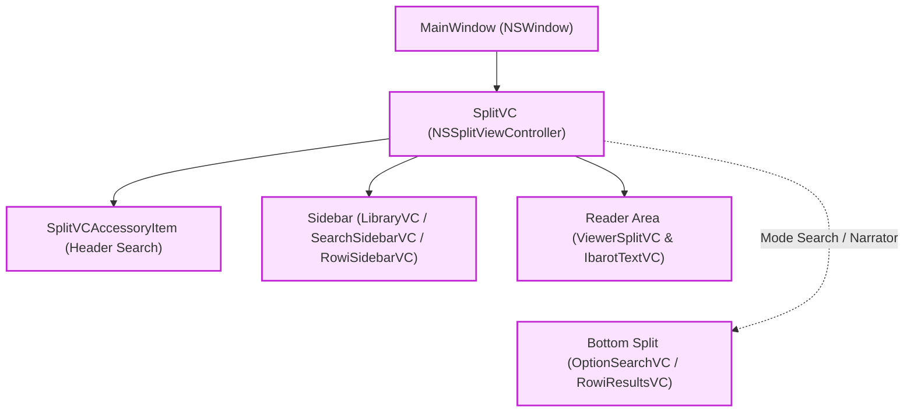

### B. Taksonomi Kontrol Toolbar (`NSToolbar`)

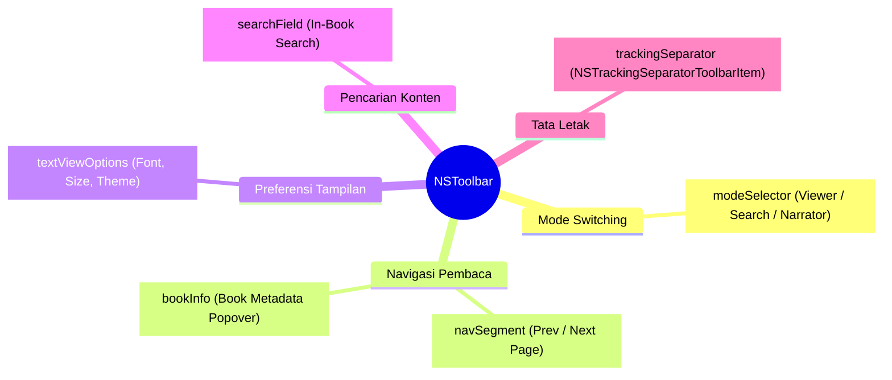

### C. Siklus Transisi Antarmode (`AppMode`)

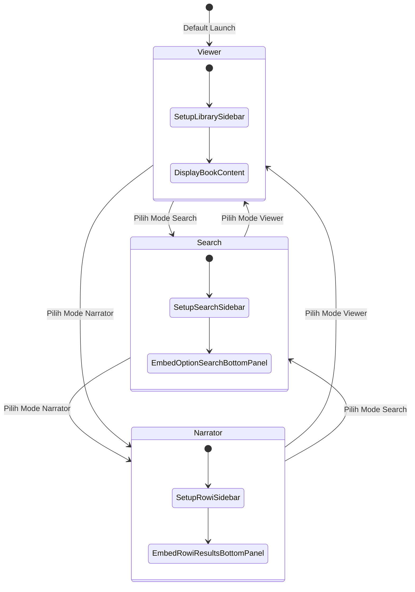

### D. Siklus Hidup Status Global: Launch, Runtime & Persistensi

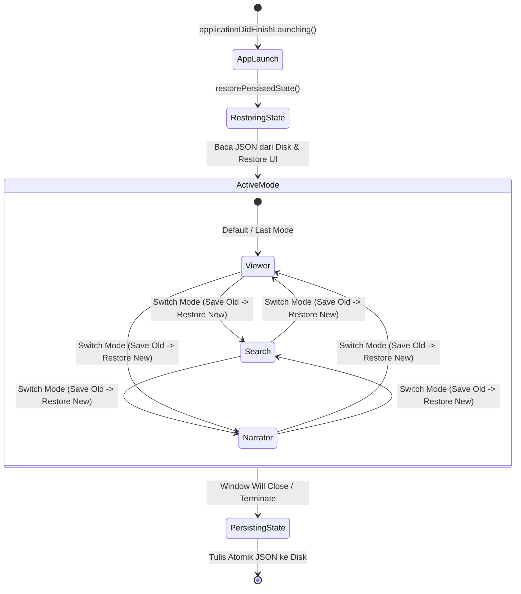

---

## 2. Alur Interaksi: Dari Aksi Klik Toolbar ke TextView

Ketika pengguna menekan tombol navigasi halaman atau memilih bab tertentu pada *toolbar* jendela utama:

### A. Alur Navigasi Halaman (Toolbar $\rightarrow$ Reader TextView)

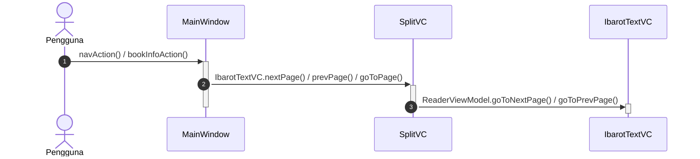

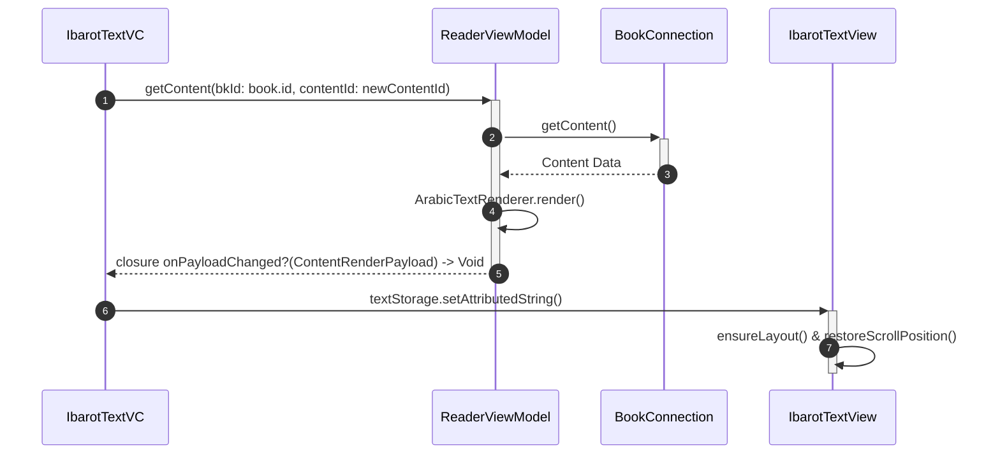

### B. Alur Penukaran Mode Antarmuka (Mode Switching & In-Memory Transfer)

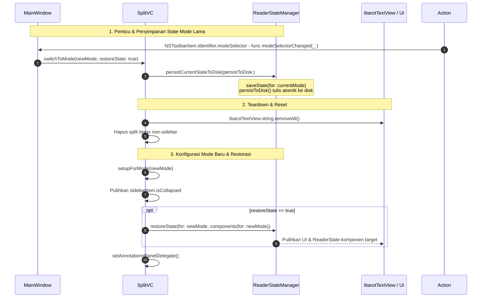

### C. Alur Restorasi State saat Peluncuran Aplikasi (*Cold Launch Restoration*)

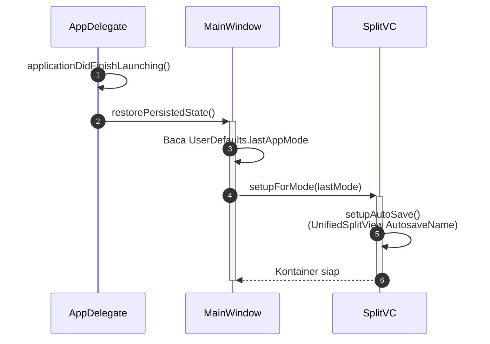

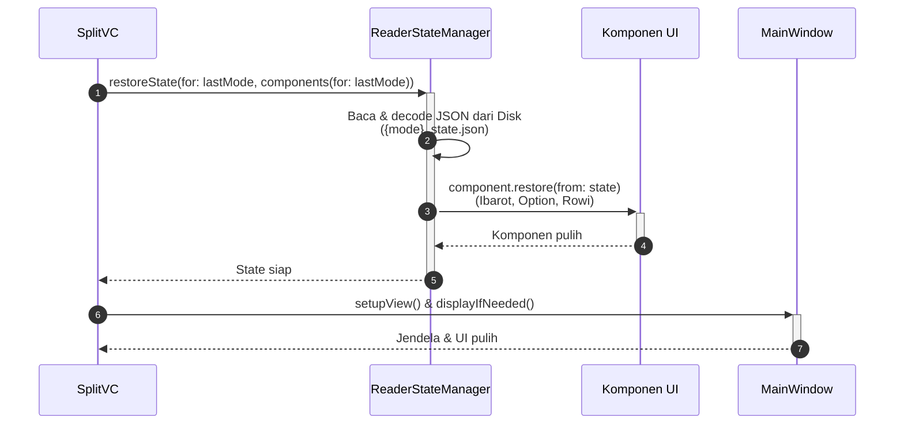

### D. Alur Peluncuran Aplikasi via Widget Deep Link (*Cold Start from Widget*)

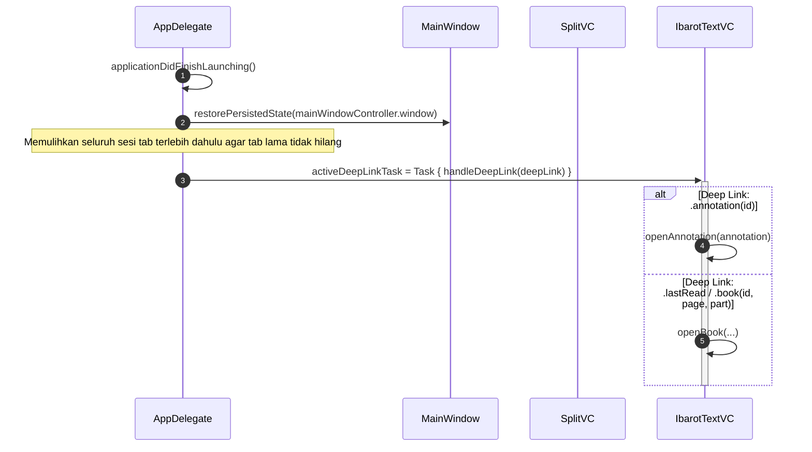

### E. Alur Persistensi Multi-Tab & Penghentian Aplikasi (*Quit & Session Persistence*)

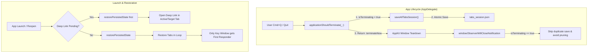

---

## 3. Bedah SplitVC & Manajemen State

`SplitVC` adalah *subclass* dari `NSSplitViewController` yang bertindak sebagai fondasi utama tata letak Maktabah pada macOS. Maktabah mendaur ulang *instance* ini untuk seluruh mode guna menghemat alokasi memori dan menjaga kelancaran animasi transisi.

### Siklus Hidup ReaderStateManager

Manajemen status antarmuka (seperti kitab aktif, nomor halaman, posisi *scroll*, rentang seleksi teks, kueri pencarian, serta status *collapsed* pada *sidebar*) dikelola oleh `ReaderStateManager` melalui 3 fase siklus:

1. **Restorasi saat Peluncuran (`restorePersistedState`)**
   - Dipicu di `AppDelegate.applicationDidFinishLaunching(_:)` saat jendela utama pertama kali dibuka.
   - Memeriksa sesi tab multi-window melalui `ReaderStateManager.loadTabsSession()`.
   - Jika berkas sesi ditemukan (`WindowTabsSession`), sistem mengiterasi seluruh snapshot tab (`[TabStateSnapshot]`):
     - Jendela pertama dijadikan basis, sedangkan jendela tab berikutnya dibuatkan *instance* `WindowController` baru dan digabungkan ke grup tab via `addTabbedWindow(newWin, ordered: .above)`.
     - Setiap tab mengimpor snapshot memorinya secara terisolasi (`splitVC.stateManager.importTabSnapshot(snapshot)`), menyetel mode, memulihkan *sidebar*, dan mengeksekusi restorasi komponen UI.
     - Tab aktif difokuskan kembali sesuai indeks `session.selectedTabIndex` (`tabGroup?.selectedWindow = activeWindow`).
   - Jika sesi tab belum tersedia, sistem memuat jendela tunggal bawaan tanpa restorasi state (`setupContentView(restoreState: false)`).

2. **Penyimpanan & Restorasi saat Beralih Mode (`switchToMode(_:restoreState:)`)**
   - Dipicu ketika pengguna memilih mode pada *segmented control* di *toolbar*, menu bar, atau melalui navigasi URL deep link widget.
   - **Guard Mode Identik**: Dievaluasi pertama kali via `guard mode != currentMode else { return }`. Apabila mode target sama dengan mode yang sedang aktif, eksekusi langsung kembali (*early return*) untuk mencegah siklus *teardown*, *render* ulang hierarki *split*, serta persistensi *disk* yang membebani CPU.
   - **Langkah 1 (Simpan Mode Lama)**: `stateManager.saveState(for: currentMode, title: ..., components: components(for: currentMode))` mengumpulkan data UI mutakhir ke memori RAM (`ReaderState`).
   - **Langkah 2 (Persistensi Instan ke Disk)**: Mengeksekusi `stateManager.persistState()` langsung saat pergantian mode agar data tidak hilang apabila aplikasi ditutup mendadak.
   - **Langkah 3 (Teardown Tampilan)**: Mengosongkan teks bacaan (`ibarotTextVC.textView.string.removeAll()`) dan menghapus seluruh item split kecuali kontainer *sidebar* persisten.
   - **Langkah 4 (Setup Mode Baru)**: Memasang *child controllers* mode baru via `setupForMode(newMode)` dan memulihkan status *collapsed* pada *sidebar* (`sidebarItem.isCollapsed`).
   - **Langkah 5 (Restorasi Mode Baru Bersyarat)**: Jika parameter `restoreState` bernilai `true` (default), `stateManager.restoreState(for: mode, components: components(for: mode))` dipanggil untuk memulihkan state komponen target. Jika dipicu dari deep link widget (`restoreState: false`), restorasi diabaikan agar konten deep link dimuat tanpa tertimpa state persisten lama.

3. **Persistensi Sesi Tab ke Disk (`saveAllTabsSession`)**
   - Menggunakan mekanisme *debounced auto-save* (3 detik via Combine `PassthroughSubject`) serta pembanding *in-memory diffing* (`lastSavedSession == session`).
   - Apabila tidak ada perubahan tab/halaman/kitab, penulisan ke disk dilewati 100% (*Zero Disk I/O*).
   - Dipicu saat fokus tab berganti (`windowObserverDidChangeKey`), reset tampilan (`resetCurrentViewState`), serta flush langsung saat aplikasi akan dihentikan (`applicationShouldTerminate`).
   - Mengambil seluruh jendela di dalam grup tab (`refWindow.tabGroup?.windows`).
   - Mengekstrak `TabStateSnapshot` dari masing-masing jendela via `splitVC.stateManager.exportTabSnapshot(currentMode:components:)`.
   - Mengemas seluruh snapshot bersama `selectedIndex` ke dalam `WindowTabsSession` dan menyimpannya secara atomik ke *disk* di `~/Library/Application Support/Maktabah/States/tabs_session.json` (`ReaderStateManager.saveTabsSession`).

### ReaderStateComponent (Protocol)

Komponen UI yang berpartisipasi dalam persistensi *state* mengadopsi *protocol* `@MainActor ReaderStateComponent`:

```swift
@MainActor
protocol ReaderStateComponent: AnyObject {
    func updateState(_ state: inout ReaderState)
    func restore(from state: ReaderState)
    func cleanUpState()
}
```

* **`updateState(_ state: inout ReaderState)`**: Mengisi properti relevan pada objek `ReaderState` (seperti ID buku, nomor halaman, posisi *scroll*, rentang seleksi, atau kueri pencarian).
* **`restore(from state: ReaderState)`**: Membaca nilai dari `ReaderState` dan menerapkannya kembali ke UI (misalnya membuka kembali kitab, memposisikan *scroll*, atau merender ulang hasil pencarian).
* **`cleanUpState()`**: Mengembalikan UI ke kondisi awal saat pengguna mengeksekusi *reset* melalui menu *Reset Current View* (`AppDelegate.resetCurrentViewState()`).

### ReaderState (Struct)

Objek *state* dienkapsulasi dalam struktur `Codable` yang disimpan pada direktori `~/Library/Application Support/Maktabah/States/`:

- `viewer_state.json`: Menyimpan *state* mode pembaca (kitab aktif, halaman, posisi *scroll*, seleksi, status TOC).
- `search_state.json`: Menyimpan *state* pencarian (kueri, opsi FTS, hasil pencarian, dan buku terpilih).
- `author_state.json`: Menyimpan *state* biografi perawi (perawi aktif, kueri rujukan, dan hasil biografi).

### TabStateSnapshot (Struct)

Model persistensi sesi multi-tab macOS untuk mempertahankan tata letak tab antar-peluncuran aplikasi:

```swift
public struct TabStateSnapshot: Codable, Equatable {
    public var currentModeRaw: Int
    public var viewerState: ReaderState
    public var searchState: ReaderState
    public var authorState: ReaderState
}
```

* Mengisolasi *state* (`viewerState`, `searchState`, `authorState`) per-tab jendela secara terisolasi.

### WindowTabsSession (Struct)

Model persistensi sesi tab jendela:

```swift
public struct WindowTabsSession: Codable, Equatable {
    public var selectedTabIndex: Int
    public var tabs: [TabStateSnapshot]
}
```

* Mengenkapsulasi seluruh tab aktif bersama indeks tab yang sedang dibuka (`selectedTabIndex`) dan disimpan pada `tabs_session.json`.

### Penanganan Jendela Ganda & Grup Tab (*Multi-Window & Tabs*)

- **Retensi WindowController**: `AppDelegate` menyimpan referensi seluruh `WindowController` aktif dalam `Set<WindowController>` (`windowControllers`) untuk mencegah deallokasi dini saat jendela tab ditambahkan.
- **Isolasi Memori Antar-Tab**: Setiap jendela tab memiliki *instance* `ReaderStateManager` mandiri. Ketika tab baru dibuka (`newWindowForTab(_:)`), tab tersebut beroperasi dengan memori *state* bersih tanpa menimpa *state* tab pendahulunya.
- **Restorasi Sesi Utuh**: Saat aplikasi diluncurkan kembali, seluruh tab yang sebelumnya terbuka dikelompokkan kembali ke dalam grup tab jendela yang sama persis dengan urutan dan posisi fokus terakhir pengguna.

### Struct, Class, & Enum Terkait

* **`AppMode` (Enum)**: Representasi mode aktif pada layar utama aplikasi (`.viewer`, `.search`, `.narrator`).
* **`SplitVC` (Class)**: Komponen sentral (`NSSplitViewController`) yang mengelola *sidebar*, *viewer*, dan panel bawah, serta meneruskan aksi seperti `nextPage()`, `prevPage()`, dan `displayAnnotations()`.

## Komponen Pendukung

=== "SplitView Logic"

    ### CustomSplitView

    `CustomSplitView` adalah *subclass* khusus `NSSplitView` yang memberikan fleksibilitas untuk mengubah tampilan pemisah panel (*divider*), menyesuaikan diri dengan skema tema bacaan (seperti sepia atau mode gelap).

    * **Warna Kustom (`customDividerColor`)**: Properti untuk menimpa (*override*) warna pembatas bawaan macOS (`.separatorColor`). Perubahan nilai memicu kalkulasi ulang tata letak melalui `setNeedsDisplay` dan `layoutSubtreeIfNeeded()` pada blok `DispatchQueue.main.async`.
    * **Ketebalan Pembatas (`dividerThickness`)**: Menetapkan ketebalan garis tepat `1.0` poin untuk menjaga estetika desain minimalis.
    * **Adaptasi Latar Belakang**: Fungsi `updateDividerColor(to bgColor: BackgroundColor)` menyuntikkan warna pemisah berdasarkan tema aktif (`.darkSepia`, `.sepia`, `.black`, `.gray`, `.white`).

=== "Toolbar & Accessory"

    ### SplitVCAccessoryItem

    Tersedia untuk target macOS 26.0+, `class` `SplitVCAccessoryItem` memfasilitasi integrasi *toolbar* dan kolom pencarian yang terbenam pada judul *sidebar* (`NSSplitViewItemAccessoryViewController`).

    * **Isolasi State Pencarian**: Membedakan `DSFSearchField` untuk setiap mode (Viewer, Search, Narrator) agar fitur *Recents Search* bawaan AppKit terisolasi menggunakan pengenal unik (seperti `"LibraryVCSearch"` atau `"RecentsRowiSidebarSearchField"`).
    * **Tata Letak Fleksibel**: Menggunakan `NSStackView` vertikal untuk menyisipkan kontrol tambahan tanpa merusak batasan Autolayout.
    * **Pembaruan Konteks (`setupView(mode:)`)**: Mengaitkan *search field* aktif ke sub-tampilan yang tepat tanpa alokasi ulang hierarki objek secara keseluruhan.

!!! note "Autosave Konfigurasi"
    `SplitVC` secara otomatis menyimpan posisi dan ketebalan *sidebar* menggunakan `autosaveName` bawaan AppKit (`"UnifiedViewerSplitView"` dan `"UnifiedSplitView"`), bekerja selaras dengan metode persistensi milik `ReaderStateManager`.
