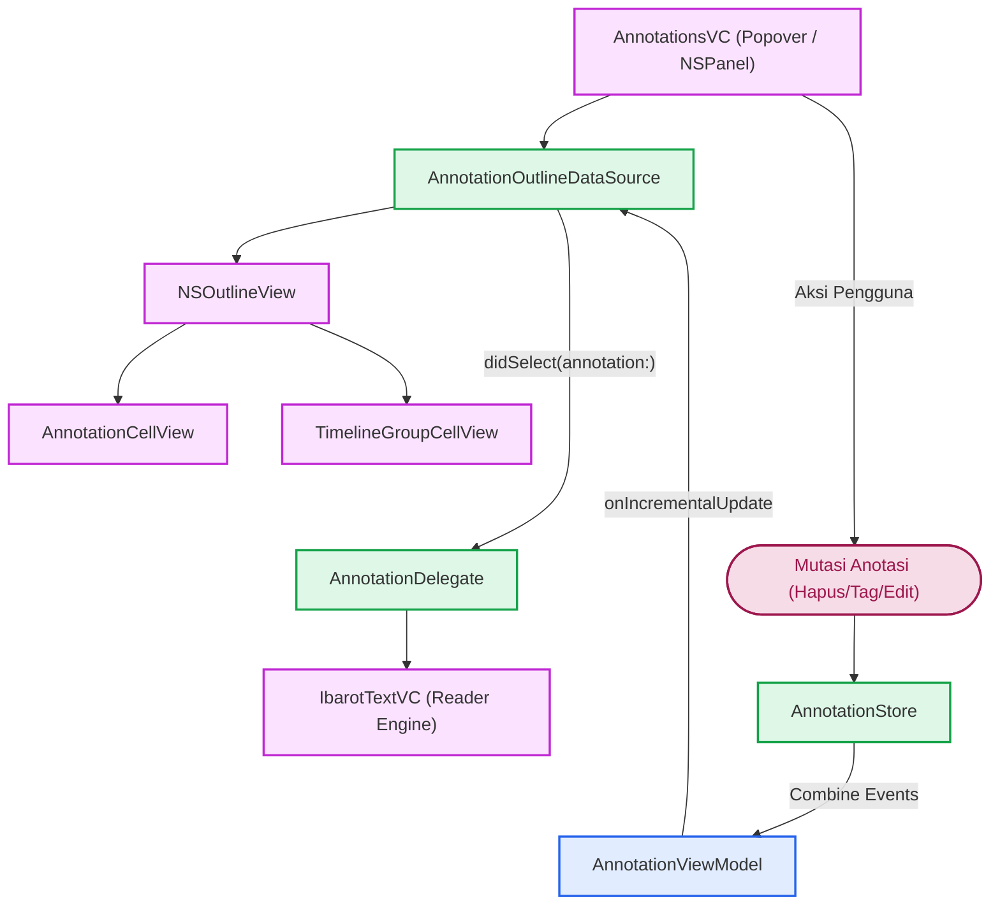
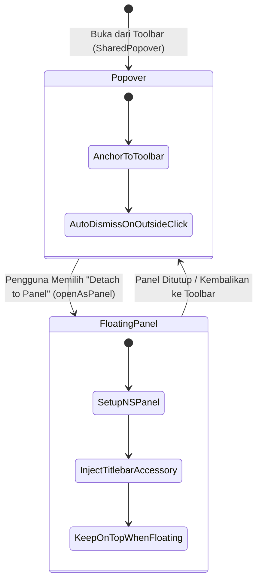
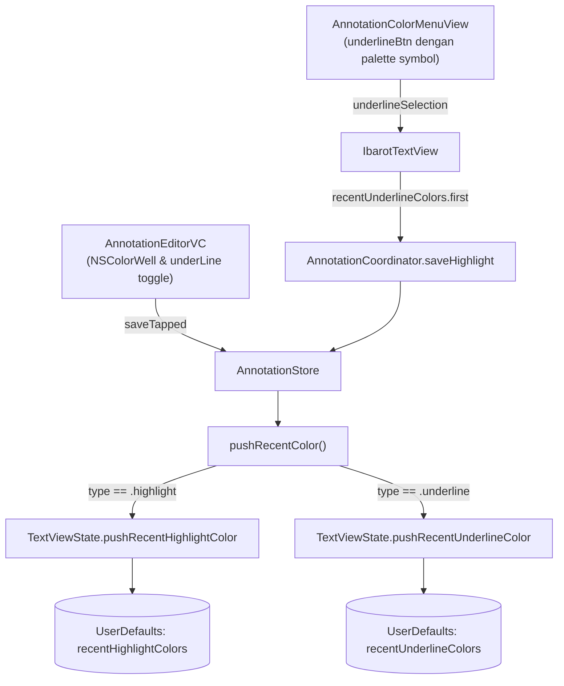

# Antarmuka Anotasi macOS

## Pendahuluan: Interaksi Komponen UI

Arsitektur antarmuka anotasi pada platform macOS didesain dengan memisahkan logika presentasi dari manajemen data. `AnnotationsVC` bertindak sebagai pengontrol utama tampilan, sedangkan `AnnotationOutlineDataSource` menangani abstraksi data dan manipulasi hierarki untuk `NSOutlineView`. Komunikasi dengan mesin pembaca (`IbarotTextVC`) dijembatani oleh *protocol* `AnnotationDelegate`.



## Mode Windowing: Popover vs. NSPanel

`AnnotationsVC` memiliki fleksibilitas mode tampilan untuk mendukung *multitasking* di macOS:



*   **Mode Popover Tersemat**:
    Secara bawaan, tampilan anotasi muncul sebagai *popover* (`SharedPopover.annotationsPopover`) yang melekat pada *toolbar* jendela utama pembaca.

*   **Mode Panel Melayang (`openAsPanel`)**:
    Pengguna dapat melepaskan *popover* menjadi jendela utilitas mandiri menggunakan `NSPanel` (`utilityWindow`, `resizable`, `closable`).

    *   `isFloatingPanel`: Bila opsi *float* aktif, panel selalu berada di atas jendela dokumen (`UserDefaults.standard.annotationFloatWindow`).
    *   `hidesOnDeactivate`: Mengontrol apakah panel otomatis disembunyikan saat aplikasi Maktabah kehilangan fokus (`NSWindow.hidesOnDeactivate`).
    *   **Injeksi Titlebar Accessory**: Saat bertransformasi menjadi panel mandiri (`setupLayoutPanel`), `titlebarRootStack` (yang berisi kolom pencarian dan filter tag) disematkan langsung ke bawah *titlebar* panel menggunakan `NSTitlebarAccessoryViewController` (`layoutAttribute = .bottom`) dengan native Auto Layout tanpa pembungkus manual atau polling ketinggian frame. Penataan stack vertikal disetel dengan perataan `.width` guna mengeliminasi batasan lebar redundan, dan `outlineView` disetel sebagai *initial first responder* pada panel dan jendela untuk mencegah fokus otomatis yang tidak diinginkan ke kolom pencarian.

## Custom TableCellView

Komponen `AnnotationCellView` adalah turunan dari `NSTableCellView` yang dirancang untuk merender detail anotasi secara kustom.

*   **Tipografi Arab & Auto Direction**:
    Variabel `context` dan `note` kini mendukung deteksi arah paragraf otomatis (RTL/LTR) secara dinamis menggunakan `AutoDirectionStyleCache` dan `applyAutoDirectionAlignments`. Hal ini menjamin keterbacaan alami untuk kutipan bahasa Arab maupun catatan pengguna dalam bahasa Latin/Indonesia. `pagePart` tetap menggunakan `BundledArabicTextField` dengan perataan kanan-ke-kiri (RTL).
*   **Opsi Visibilitas Tanggal**:
    Elemen tanggal (`dateTextField`) dapat disembunyikan berdasarkan preferensi `UserDefaults.standard.showAnnotationDate`. Saat disembunyikan, label tanggal ditiadakan dari hierarki tampilan dan ruang lebar sel dialokasikan sepenuhnya untuk teks kutipan.

*   **Tata Letak**:
    Elemen antarmuka disusun menggunakan `NSStackView` vertikal dengan batasan fleksibel (`contentStackLeadingConstraint` dan `contentStackTrailingConstraint`) untuk menyesuaikan ruang margin secara dinamis.

*   **Elemen Linimasa**:
    Sel memiliki `timelineRail` dan `timelineDot`. Elemen ini dimunculkan saat antarmuka beralih ke mode linimasa melalui fungsi `setTimelineInset(_:)`.

*   **Pembatas Sisi**:
    Terdapat batas dekoratif (*border box*) pada sisi kanan dan bawah untuk memisahkan antarkolom dan baris pada mode non-linimasa.

## TimelineOutlineViews

Berkas `TimelineOutlineViews.swift` bertanggung jawab atas elemen visual penunjuk linimasa pada judul grup.

*   **TimelineNodeView**:
    *Subclass* `NSView` kustom yang berfungsi menggambar titik *node* secara manual menggunakan jalur `NSBezierPath`.

*   **TimelineGroupCellView**:
    Digunakan khusus untuk baris grup saat mode linimasa aktif. Sel ini menggabungkan `topTimelineRail` dan `bottomTimelineRail` untuk menciptakan jalur vertikal yang tersambung antar-sel.

## Logika Grouping Modes

`NSOutlineView` dapat mengelompokkan data berdasarkan Buku, Tag, atau Linimasa. Transisi antarmode dikelola oleh `AnnotationOutlineDataSource`.

*   **Konfigurasi Visual**:
    Metode `applyOutlineViewConfiguration()` menyesuaikan tata letak tabel ketika terjadi perpindahan mode:
    *   Mode Linimasa: Properti `floatsGroupRows` diaktifkan agar *header* grup melayang saat digulir, parameter `indentationPerLevel` disetel ke 0, dan jarak antar-sel dihilangkan.
    *   Mode Standar: Parameter `indentationPerLevel` disetel ke 13 guna memberikan indentasi margin pada struktur hierarki.
*   **Penyusunan Hierarki (*Tree Builder*)**:
    Data dari pengontrol hierarki direpresentasikan dalam bentuk struktur hierarki oleh `AnnotationTreeBuilder`. Relasi *parent-child* ini dibaca oleh `NSOutlineView` untuk merender baris sesuai mode yang aktif.

## Kalkulasi Tinggi Baris Dinamis (`AnnotationRowHeightCalculator`)

Karena kutipan teks Arab, catatan pengguna, serta daftar tag memiliki panjang yang bervariasi, penentuan tinggi baris dilakukan melalui `@MainActor enum AnnotationRowHeightCalculator` dengan menonaktifkan `usesAutomaticRowHeights` pada `NSOutlineView` demi performa optimal:

*   **Pengukuran Komponen Teks (`measuredHeight`)**:
    *   Kutipan teks Arab (`context`): Dipotong terlebih dahulu (*pre-truncated*) via `displayContext` (`truncatedForCellDisplay(maxCharacters: 350, maxNewlines: 2)`) dan dibatasi oleh nilai preferensi `UserDefaults.standard.ctxMaxNumberOfLines`.
    *   Catatan tambahan (`note`): Dipotong via `displayNote` (`truncatedForCellDisplay(maxCharacters: 500, maxNewlines: 4)`) dan dibatasi oleh `UserDefaults.standard.annMaxNumberOfLines`.
    *   Metadata (`pagePart`): Dibatasi maksimal 3 baris (`pagePartLineLimit = 3`) untuk mengakomodasi pembungkusan nomor jilid/halaman dan daftar tag.
*   **Alokasi Lebar Dinamis**:
    Saat `showAnnotationDate` bernilai `true`, lebar tanggal (`dateWidth + 12`) dikurangkan dari lebar baris untuk menghasilkan `contextWidth`. Apabila tanggal disembunyikan, `contextWidth` menggunakan lebar penuh `contentWidth`.
*   **Formula Padding & Spacing**:
    Menghitung tinggi total secara presisi dengan formula:
    $$\text{Total Height} = \lceil 23 + \text{topSectionHeight} + \text{pagePartHeight} + \text{noteHeight} + \text{stackSpacing} \rceil$$
    dengan:
    $$\text{topSectionHeight} = \begin{cases} \max(\text{contextHeight}, 26) & \text{jika } \text{showAnnotationDate} = \text{true} \\ \max(\text{contextHeight}, 20) & \text{jika } \text{showAnnotationDate} = \text{false} \end{cases}$$
    $$\text{stackSpacing} = \begin{cases} 16 & \text{jika } \text{noteHeight} > 0 \\ 8 & \text{jika } \text{noteHeight} = 0 \end{cases}$$
    Metode ini dipanggil langsung oleh `outlineView(_:heightOfRowByItem:)` pada `AnnotationsOutlineDelegate`, dan cache tinggi baris diinvalisir saat kolom tabel diubah ukurannya (*column resize*).

## Interaksi Pengguna & Navigasi Reader

Saat pengguna berinteraksi dengan daftar baris:

1.  **Seleksi Anotasi**:
    Ketika baris anotasi dipilih, delegasi `outlineViewSelectionDidChange(_:)` mendeteksi perubahan. Jika item yang dipilih adalah *leaf node* (`AnnotationNode` yang memiliki objek `Annotation`), delegasi memanggil:
    ```swift
    delegate?.didSelect(annotation: annotation)
    ```

2.  **Penanganan di Mesin Reader**:
    Objek `AnnotationOutlineDataSource.delegate` dihubungkan ke `IbarotTextVC` oleh `SplitVC`. Saat `didSelect(annotation:)` diterima:
    *   Kitab yang sesuai dimuat jika belum aktif.
    *   Halaman target dibuka melalui `contentId`.
    *   Kursor dan posisi gulir diarahkan ke rentang teks anotasi yang bersangkutan (`highlightRange`).

## Aksi Baris, Menu Konteks & Pengeditan

macOS menyediakan interaksi langsung dari *sidebar*:

*   **Trailing Swipe Action (Hapus)**:
    Mengimplementasikan `NSTableViewDelegate.tableView(_:rowActionsForRow:edge:)` pada sisi `.trailing`. Menyediakan aksi geser dengan ikon `trash.slash.fill` untuk menghapus anotasi terpilih secara instan.
*   **Menu Konteks Baris (`AnnotationMenu`)**:
    Menyediakan aksi klik kanan: Salin teks (`copyMenuItem`), Sunting Anotasi (`editMenuItem` — hanya aktif pada satu baris anotasi terpilih dan menyajikan popover `AnnotationEditorVC` yang dijangkarkan secara presisi pada sel via `outlineView.cellAnchor(forRow:)`), Tambah/Hapus Tag, Ubah Tipe (*Highlight* vs. *Underline*), serta opsi hapus.
*   **Menu Palet Warna Cepat (`AnnotationColorMenuView`)**:
    Menampilkan deretan titik warna di dalam menu konteks untuk *highlight* serta tombol *underline* terdedikasi. Ikon *underline* dikonfigurasi menggunakan SF Symbol dengan `NSImage.SymbolConfiguration(paletteColors:)` yang mencerminkan warna terakhir dari `recentUnderlineColors` (fallback ke `.labelColor`).
*   **Panel Editor Anotasi (`AnnotationEditorVC`)**:
    Panel *popover* untuk mengedit catatan teks lengkap, mengubah tipe (*highlight* vs. *underline*), memilih warna dari `NSColorWell`, serta mengatur tag melalui `NSTokenField`. Nilai warna disinkronkan secara otomatis: jika tipe *underline* aktif, warna disimpan dan dipush ke `UserDefaults.standard.recentUnderlineColors`, sehingga pembuatan *underline* berikutnya secara konsisten memakai warna tersebut.
*   **Menu Opsi Tampilan & Batas Baris (`AnVC+LineMenu.swift`)**:
    Menyediakan pengaturan jumlah batas baris untuk kutipan (`ctxMaxNumberOfLines`) dan catatan (`annMaxNumberOfLines`), serta *toggle* visibilitas tanggal anotasi (`showAnnotationDate`). Perubahan preferensi tanggal langsung memperbarui kalkulasi tinggi baris dan memicu pembaruan tata letak *outline view*.

### Alur Persistensi Warna Anotasi (Highlight & Underline)



## Pencarian & Scope Panel Melayang

*   **Kolom Pencarian (`DSFSearchField`)**:
    Terintegrasi dengan *debounce* di `AnnotationViewModel.searchText`. Perubahan teks secara asinkron menyaring struktur hierarki anotasi.
*   **Scope Panel Melayang (`scopePanel`)**:
    Ketika kolom pencarian aktif, sebuah `NSPanel` melayang tak berbingkai (`level = .popUpMenu`) muncul tepat di bawah kolom pencarian. Panel ini memuat kontrol segmen (`NSSegmentedControl`) yang membatasi cakupan pencarian berdasarkan `AnnotationSearchScope`: Semua (*All*), Kitab (*Book*), Konteks (*Context*), Catatan (*Notes*), atau Tag (*Tags*). Ketika kueri atau cakupan berganti, hierarki disaring secara seketika (*real-time*) dan item induk diperluas (*expanded*) agar hasil yang cocok langsung terlihat.

## Manajemen Filter Tag & Penggabungan Tag

*   **Penyusunan Bilah Filter (`createTagFilterBar`)**:
    Antarmuka filter dirancang menggunakan `NSStackView` secara programatik, mencakup tombol filter, sakelar logika (AND/OR), serta area gulir horizontal (`NSScrollView`) untuk menampung *tag chips*.
*   **Penyematan Aksesori (*Accessory Injection*)**:
    Saat dalam mode panel mandiri, `NSStackView` tersebut dibungkus sebagai `view` utama milik `NSTitlebarAccessoryViewController` (`layoutAttribute = .bottom`), melekat di bawah *titlebar*.
*   **Tag Popover (`AnnotationTagVC`)**:
    Ditampilkan saat aksi penambahan atau penghapusan tag dipicu dari menu baris atau *toolbar*.
*   **Penggabungan Tag (`TagMergePopoverVC`)**:
    Menyediakan dialog *popover* untuk menggabungkan (*merge*) dua tag berbeda menjadi satu nama tag di seluruh basis data anotasi.

## Penerimaan Event Combine

Aplikasi memanfaatkan observasi Combine untuk merespons pembaruan status secara efisien tanpa memuat ulang antarmuka secara keseluruhan.

!!! note "Mekanisme Pembaruan Inkremental"
    Setiap perubahan data memicu pengiriman objek `AnnotationTreeDiff` melalui metode `onIncrementalUpdate`. Objek *diff* ini memberikan pedoman rinci bagi *data source* perihal baris spesifik yang perlu dimodifikasi.

*   **Saat Menghapus Anotasi**:
    1. Tindakan hapus memperbarui `AnnotationStore`, yang kemudian memicu ViewModel menghasilkan objek *diff* dengan tipe `.deleted`.
    2. `AnnotationOutlineDataSource` menerima objek *diff* ini dan mengeksekusi metode `handleDeletedAnnotation()`.
    3. Fungsi ini mencari posisi indeks baris spesifik dan menghapusnya menggunakan `removeItems(at:inParent:withAnimation:)` disertai animasi pergeseran `slideUp`.
    4. Apabila *parent node* menjadi kosong akibat penghapusan *child node*, metode `cleanupEmptyParentNode()` membersihkan nama grup tersebut dari layar.
*   **Saat Membuka Popover Tag**:
    1. Permintaan manipulasi tag memancarkan sinyal `onAddTagsRequested` atau `onRemoveTagsRequested`.
    2. Lapisan kontrol `AnnotationsVC` merespons dengan menampilkan *popover* pemilihan tag.
    3. Saat pengguna menyimpan perubahan tag, sistem menyusun objek `TagUpdateDiff`.
    4. Metode `handleTagModeUpdate()` memproses perubahan secara aman: pembuangan parent node yang kosong dipisahkan dari mutasi child node (`applyTagModeRemovals`), penambahan node grup baru digabungkan (*batching*) ke dalam `IndexSet`, dan pemanggilan `outlineView.reloadItem` ditunda hingga sesudah blok `outlineView.endUpdates()` selesai dieksekusi guna mencegah inkonsistensi indeks internal `NSOutlineView`.
