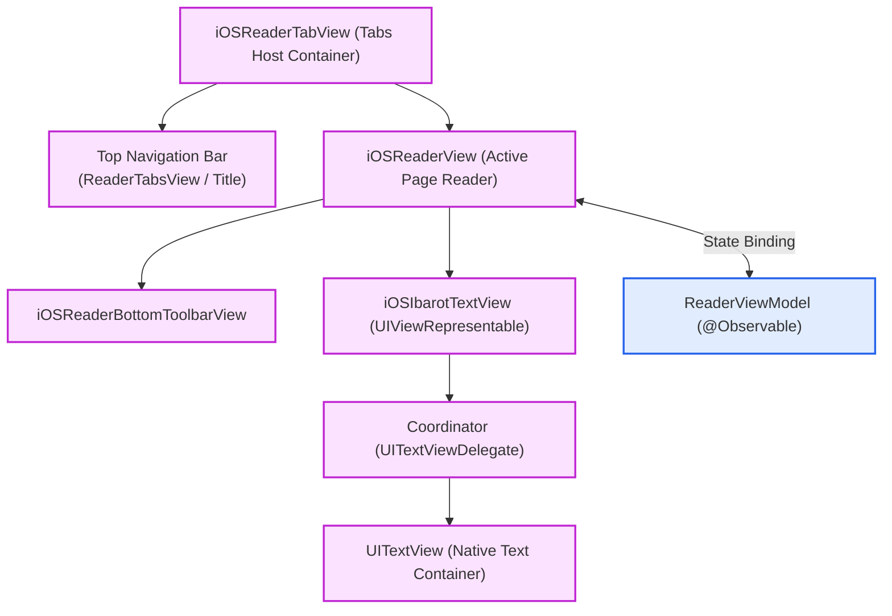
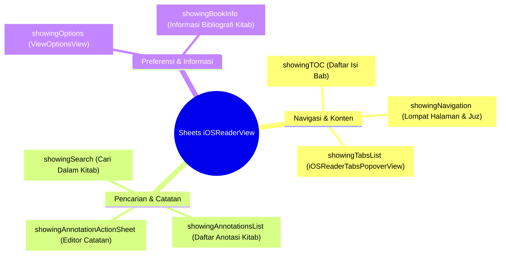
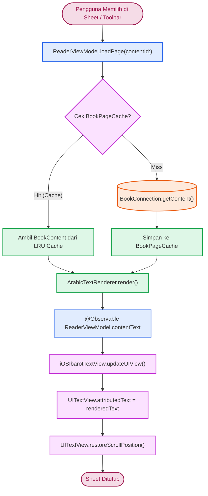

# Reader iOS Implementation (SwiftUI & UIKit)

Implementasi antarmuka layar pembaca pada platform iOS menggunakan integrasi antara arsitektur deklaratif **SwiftUI** (sebagai pengelola kontainer, *toolbar*, dan lembar modal) dan **UIKit** (`UITextView` melalui `UIViewRepresentable`) demi stabilitas tipografi teks Arab berharakat serta performa *rendering* yang tinggi.

Sumber kode: `Source/Features/Reader/iOS/`

---

## 1. Arsitektur Komponen Visual

Arsitektur antarmuka pembaca iOS mengombinasikan orkestrasi modal deklaratif SwiftUI dengan *rendering engine* UIKit:

### A. Hierarki Kontainer Pembaca

### B. Taksonomi Lembaran Modal (*Toolbar Sheets*)

---

## 2. Alur Interaksi: Dari Aksi Klik Toolbar / Sheet ke TextView

Ketika pengguna memilih bab dari Daftar Isi (TOC), melompat ke halaman tertentu, atau mengetuk hasil pencarian dalam kitab:

---

## 3. Bedah Komponen & Logika Antarmuka

### A. Ekosistem Lembaran Toolbar (*Toolbar Sheets Manager*)
`iOSReaderView` mengontrol visibilitas tampilan modal melalui variabel `@State` boolean terdedikasi:

| Variabel State | Komponen Sheet | Fungsi Utama |
| :--- | :--- | :--- |
| `showingTOC` | `iOSTOCView` | Menampilkan struktur hierarki bab (*outline*) kitab. |
| `showingOptions` | `ViewOptionsView` | Mengonfigurasi ukuran font Arab, famili font, visibilitas harakat, dan tema latar belakang (`BackgroundColor`: Sepia, Dark Sepia, Gray, Black, White). |
| `showingSearch` | `iOSBookSearchView` | Pencarian teks cepat khusus di dalam halaman-halaman kitab aktif. |
| `showingAnnotationsList` | `iOSBookAnnotationsView` | Menampilkan seluruh penanda dan catatan teks yang tersimpan untuk kitab ini. |
| `showingBookInfo` | `iOSBookInfoView` | Kartu informasi bibliografi, penerbit, nomor cetakan, dan tahun wafat pengarang. |
| `showingAnnotationActionSheet` | `iOSAnnotationEditorSheet` | Panel modal penyuntingan isi catatan (*note*), pergantian warna sorotan, atau penghapusan anotasi. |
| `showingNavigation` | `PageJumpSheet` | Bilah geser (*slider*) cepat dan kolom masukan nomor halaman/juz. |

> [!NOTE]
> **Sentralisasi Daftar Tab Kompak (`showingTabsList`):**
> Variabel status `showingTabsList` yang menyajikan `iOSReaderTabsPopoverView` pada tata letak kompak dipindahkan dari `@State` lokal `iOSReaderView` ke `iOSNavigationManager.showingTabsList`. Lembar ini dipusatkan di tingkat root `iOSMainView` guna mencegah tumpang-tindih hierarki modal dan mempertahankan isolasi *view*.

### B. Jembatan iOSIbarotTextView (UIViewRepresentable) & Isolasi Layout
Mengintegrasikan `UITextView` UIKit ke dalam arsitektur deklaratif SwiftUI dengan perlindungan tata letak TextKit 2:

* **`makeUIView`**: Menginisialisasi `UITextView` kustom (`iOSCustomIbarotTextView`) dengan properti *non-editable*, *selectable*, serta mendukung perpindahan per halaman (*paging mode*) maupun pengguliran kontinu (*continuous scrolling*).
* **`updateUIView`**: Menerima injeksi `NSAttributedString` baru dari `ReaderViewModel`. Pada metode ini, lapisan warna anotasi dan sorotan kata kunci pencarian diterapkan secara dinamis berdasarkan kalkulasi rentang teks. Mutasi `textAlignment` dan atribut semantik teks diproteksi dengan guard nilai saat ini guna mencegah pembatalan hierarki tata letak TextKit 2 yang berat pada halaman panjang.
* **Isolasi Render Lembar Modal (`ReaderTextContentView: Equatable`)**: Tampilan pembaca dibungkus dalam *struct* terisolasi yang mengadopsi `Equatable`. Hal ini mencegah SwiftUI mengevaluasi ulang *Text View* ketika status *sheet* (seperti TOC atau opsi tampilan) dimutasi oleh kontainer induk.
* **Stabilisasi Posisi Scroll & Caching Coordinator**:
  - **Offset Dokumen Murni**: Posisi gulir dikalkulasi relatif terhadap dokumen aktual (`liveDocY = max(0, contentOffset.y + effectiveTopInset)`), mengompensasi penyesuaian dinamis `adjustedContentInset.top` saat *safe area* berubah.
  - **Guard `isRestoringScroll`**: Variabel penanda pada `iOSCustomIbarotTextView` memblokir delegasi gulir pengguna selama fase restorasi berlangsung, mencegah pembaruan status liar (*stale scroll state*) saat TextKit 2 menghitung fragmen tata letak.
  - **Penangguhan Restorasi (`pendingRestoreOffset`)**: Penerapan offset ditangguhkan hingga tata letak teks dan batas kontainer (*bounds*) mapan di `layoutSubviews()`, kemudian dieksekusi secara presisi melalui `applyPendingScrollRestore()`.
  - **Retensi Caching Coordinator**: Objek `Coordinator` menyimpan `lastKnownScrollPosition` pada setiap event delegasi gulir (`scrollViewDidScroll`, `scrollViewDidEndDecelerating`, dll.). Saat tampilan bertransisi atau belum terpasang di jendela (`window == nil`), fungsi `fetchScrollPosition` mengembalikan nilai cache ini sehingga posisi bacaan tidak pernah hilang (*zero scroll loss*).
* **`Coordinator` (`UITextViewDelegate`)**: Menangani interaksi seleksi teks untuk menu *highlight/underline*, mencegat ketukan anotasi (`onTapAnnotation`), serta mengisolasi status de-duplikasi animasi event pencarian dan anotasi (`lastHandledSearchEventId`, `lastHandledAnnotationEventId`) per *instance* aktif.
* **Pencegahan Reset Gulir (*Scroll Reset*) pada Halaman Aktif**: Pemuatan konten (`fetchContentById` dan `iOSNavigationManager.openBookInActiveTab`) memverifikasi apakah *tab* aktif telah menampilkan buku dan `contentId` yang dituju. Jika identik, sistem melewati pemuatan ulang dan *layout pass*, mencegah posisi gulir teks pembaca melompat kembali ke atas saat berinteraksi dengan anotasi pada halaman aktif.

### C. Penanganan Ekstensi UI & Mode Membaca Layar Penuh (*Fullscreen*)

* **Toggle Fullscreen Mode**: Pada tata letak kompak (`!isRegularLayout`), pengguna dapat mengetuk teks untuk menyembunyikan bilah navigasi atas dan *toolbar* bawah (`isReading.toggle()`), memberikan ruang baca penuh yang imersif.
* **Geometri Layar & Rotasi**: Saat *toolbar* disembunyikan atau orientasi perangkat diputar (*Portrait* $\leftrightarrow$ *Landscape*), tata letak UIKit menyesuaikan *safe area insets* dan melakukan pemulihan posisi gulir (*scroll position restoration*) agar paragraf yang sedang dibaca tidak bergeser.

### D. Arsitektur Navigasi Multi-Tab iOS (`ReaderTabsView`)

Navigasi multi-tab pada `iOSReaderTabView` dirancang untuk mengelola banyak kitab sekaligus dengan efisiensi tata letak tinggi:

* **Pengguliran Horizontal & Auto-Scroll (`ScrollViewReader`)**: Komponen `ReaderTabsView` menggunakan `ScrollView(.horizontal)` yang dibungkus `ScrollViewReader`. Ketika tab aktif berganti, sistem secara otomatis menganimasikan pengguliran ke tab tersebut (`proxy.scrollTo(id, anchor: .center)`).
* **Pembatasan Lebar & Truncation**: Setiap item tab (`ReaderTabItemView`) dibatasi lebarnya maksimal 250pt dengan pemotongan teks berekor (*tail truncation*) agar judul kitab yang panjang tidak mendominasi layar. Ketinggian tombol beradaptasi otomatis saat kelas ukuran vertikal kompak (`verticalSizeClass == .compact`).
* **Responsif Multi-Tasking Berbasis Size Class**: Menggunakan `@Environment(\.horizontalSizeClass)` (`isRegularLayout`) menggantikan deteksi perangkat kaku (`MaktabahApp.isIpad`). Pada layout reguler (iPad layar penuh), deretan tab ditampilkan langsung di bilah atas (`.principal`). Pada layout kompak (iPhone atau iPad dalam Split View / Slide Over), tombol judul kitab aktif disematkan di sisi *trailing* untuk memunculkan lembar `iOSReaderTabsPopoverView`.
* **Preservasi Scroll Offset Antar-Tab**: Deklarasi `.toolbar` diposisikan di luar modifier `.id(activeTab.id)` pada `iOSReaderTabView`, sehingga pergantian tab tidak menghancurkan struktur toolbar dan menjaga posisi gulir teks pembaca.
* **Snapshot State Popover**: `iOSReaderTabsPopoverView` memanfaatkan snapshot lokal (`highlightedTabId`) saat `.onAppear` untuk mengeliminasi kedipan indikator seleksi visual (*selection flicker*) saat pengguna memilih tab baru.

